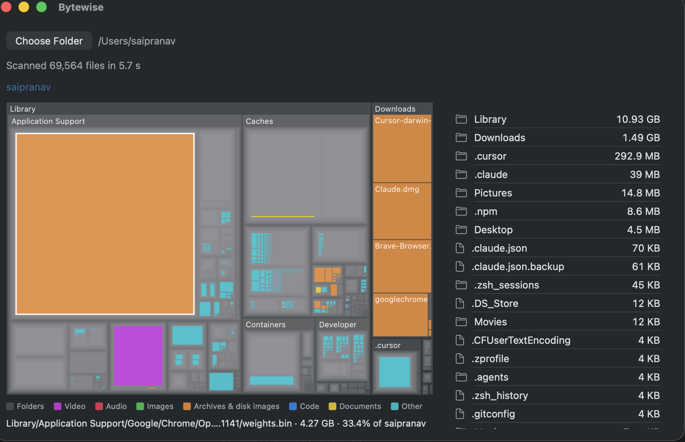
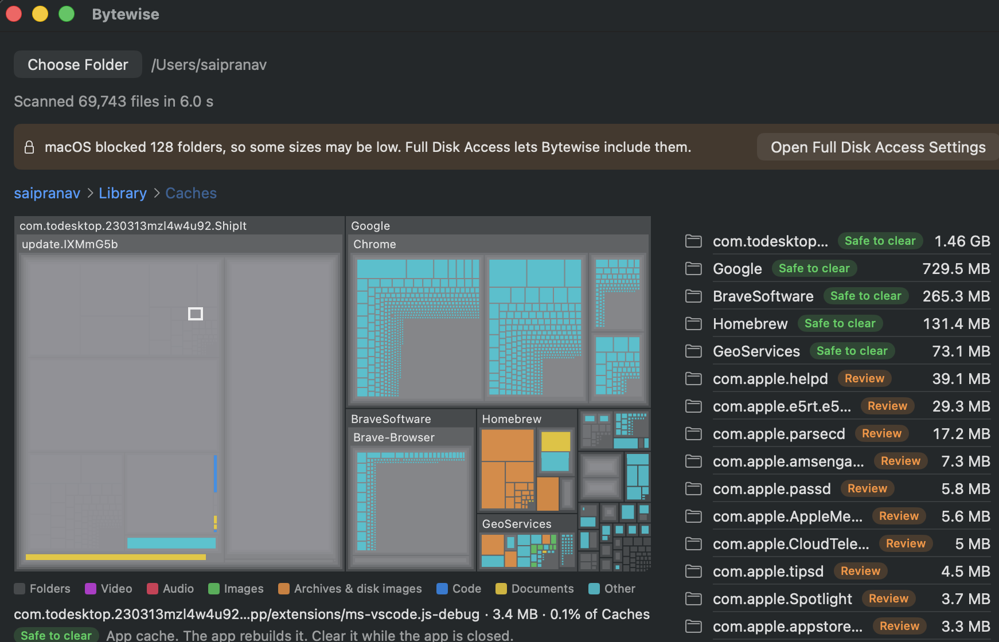
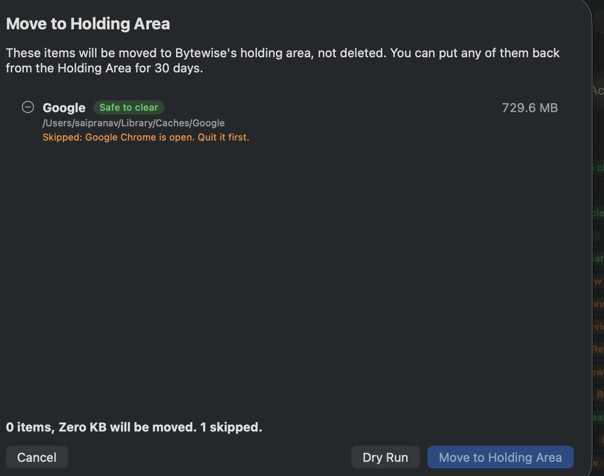

# Bytewise

A native macOS app that shows where your disk space went, explains in plain words what each location is, and cleans up safely: nothing is deleted without a preview, and every move can be undone.



## Features

- **Size map.** A squarified treemap of any folder. Bigger rectangles use more space, and colours show the kind of file. Hover for name, size and share; click a folder to open it; use the path bar to go back up.
- **Plain-language labels.** Common locations get a verdict (*Safe to clear*, *Review*, *Keep* or *Managed by macOS*) and a one-line reason, such as "App cache. The app rebuilds it. Clear it while the app is closed."
- **Safe cleanup.** Pick items, preview exactly what will move and why, try a dry run, then move them to a holding area. Undo straight away, or restore any item later, even after quitting the app.
- **AI model manager.** Finds downloaded AI models from Ollama, Hugging Face, LM Studio, GPT4All, PyTorch and Chrome's on-device model, plus large `.gguf`, `.safetensors` and similar files, with size and last use. These models often take tens of gigabytes without anyone noticing.
- **Full Disk Access notice.** After a scan, Bytewise tells you how many folders macOS blocked, and links to the right settings page.
- **Settings.** Choose folders to leave out of scans, and how long the holding area keeps items.



## Privacy

- Everything stays on your Mac. There is no account, no analytics, and no network access.
- Bytewise reads file names, sizes and dates. It never opens your files. The AI model manager works out model names from folder and file names too.

## Safety

These rules are in the code and covered by tests:

1. **Nothing is deleted directly.** Cleanup moves items into a holding area inside the app's own container, and logs every move. Items can only be deleted for good after the holding period (30 days by default), and only after you confirm.
2. **Preview first.** Every cleanup shows each item, its size, its verdict and its reason, and offers a dry run that changes nothing.
3. **User data and system files are never offered.** Rules for Documents, Desktop, Photos, iCloud Drive, Mail, app containers and system folders are checked first, so no later rule can mark anything inside them as safe. Items with no matching rule can't be selected either.
4. **Open apps are protected.** Items that belong to a running app, such as Chrome's cache while Chrome is open, are skipped.
5. **Conservative labels.** Only app caches and Xcode's DerivedData are marked *Safe to clear*. Anything less certain is marked *Review*.



## Requirements

- macOS 26.6 or later
- Xcode 27 or later, to build from source

## Build and run

1. Clone the repository and open `Bytewise.xcodeproj` in Xcode.
2. Choose the **Bytewise** scheme and **My Mac**, then press **⌘R**.
3. Click **Choose Folder** and pick a folder, such as your home folder.

You don't need a paid Apple Developer account to build and run on your own Mac.

To run the tests, press **⌘U** in Xcode, or run:

```sh
xcodebuild test -project Bytewise.xcodeproj -scheme Bytewise -destination 'platform=macOS'
```

### Opening a downloaded build

Builds published here are not notarized by Apple, so macOS warns the first time you open one. To open it anyway, right-click the app in Finder and choose **Open**. If macOS still blocks it, go to **System Settings › Privacy & Security** and click **Open Anyway**.

### Full Disk Access

macOS protects some folders, such as Mail, Messages and parts of Library. To include them in scans, turn on Bytewise in **System Settings › Privacy & Security › Full Disk Access**. Bytewise works without it, but some sizes will be lower than they really are.

Builds signed only to run locally (Xcode's default without a team) get a new identity each time they're rebuilt, so macOS may forget this permission after a rebuild. Choosing your Personal Team under **Signing & Capabilities** avoids that.

## How it works

| Part | Where | What it does |
|---|---|---|
| Scanner | `Bytewise/Scanner` | Walks the folder in the background with `FileManager`, builds a tree with sizes added up, and reports progress. It can be cancelled. Uses allocated size (what the disk really uses), skips symbolic links, and records folders it couldn't read. |
| Size map | `Bytewise/Views/TreemapLayout.swift`, `TreemapView.swift` | Squarified treemap layout (Bruls, Huizing and van Wijk), drawn with SwiftUI `Canvas`. Rectangles of the same colour are merged into one path, so drawing takes a handful of fills however many items are shown. |
| Rules | `Bytewise/Rules` | An ordered list of path rules; the first match wins. User-data and system rules come first. |
| Cleanup | `Bytewise/Cleanup` | Plans moves (the dry run), moves items into the holding area, keeps a JSON log, restores items with a saved security-scoped bookmark, and checks which apps are open. |
| AI models | `Bytewise/AI` | Finds models by where common tools keep them, using names and sizes only. |

The app is sandboxed. It can read and write only the folders you choose, which acts as a safety net around cleanup.

## Measurements

Measured on the author's Mac:

| Test | Result |
|---|---|
| Scan of the Xcode app bundle (125,860 files) | 1.5 s, about 84,000 files per second |
| First scan of a home folder (69,437 files) | 11.1 s, about 6,300 files per second |
| The same scan again, with the disk cache warm | 2.4 s, about 29,000 files per second |
| Size map layout for a 1200 × 800 window | under 1 ms |
| Sizes compared with `du` on three folders | exact match on two. The third (`/usr/share`) came out a little higher, because Bytewise counts hard-linked files once for each link and `du` counts them once. |
| Unit tests | 79 test cases, covering the scanner, size map layout, rules (including paths that must never be marked safe), holding area, open-app checks, AI model finder and error messages |

## Known limitations

- Hard-linked files are counted once for each link, so a few system folders show slightly more than `du` does.
- The open-app check compares folder names with app names and bundle IDs. It catches common cases, such as Chrome and Brave caches, but not every one.
- Items on other disks can't be moved to the holding area yet.
- "Last used" dates are approximate, because macOS does not always record when a file was opened.
